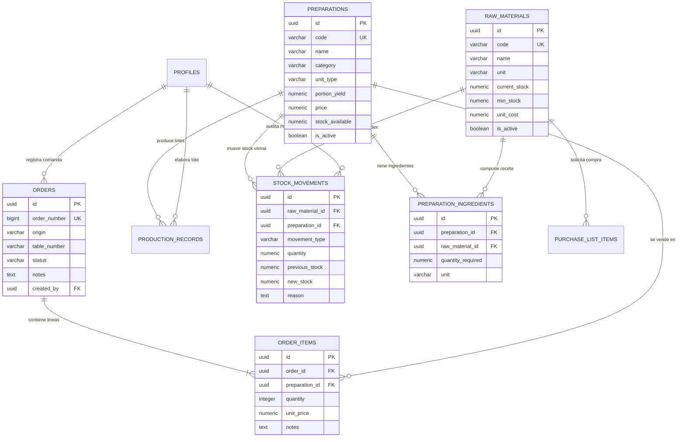

# DULCE TALLER - SISTEMA POS & CONTROL DE PRODUCCIÓN
## MEMORIA TÉCNICA Y DE ARQUITECTURA DE SOFTWARE
**Carrera:** Tecnicatura Superior en Desarrollo de Software  
**Institución:** Instituto de Formación Técnica Superior N° 29 (IFTS 29)  
**Materia:** Práctica Profesionalizante II  
**Versión:** 1.0 (Producción / Release Candidate)  
**Fecha:** Octubre 2026  

---

## 1. INTRODUCCIÓN Y PLANTEO DEL PROBLEMA

### 1.1 Contexto del Negocio
**Dulce Taller** es una pastelería artesanal y cafetería de especialidad que combina tres unidades de negocio en un mismo espacio físico:
1. **Salón de cafetería y degustación** (atención por mesas con rotación rápida).
2. **Mostrador Take-Away / Despacho de Vitrina** (venta de productos al paso y tortas enteras para eventos).
3. **Talleres y Workshops de Pastelería Participativa** (actividades formativas grupales).

### 1.2 Problemática Detectada
En los sistemas POS gastronómicos genéricos del mercado, el modelo de inventario suele ser lineal: cada producto vendido descuenta directamente insumos o productos terminados sin distinción. En una pastelería artesanal, este enfoque falla críticamente debido a:
- **Disociación Temporal de la Producción:** La torta no se hornea cuando el comensal la pide en la mesa; se hornea horas o días antes en la cocina por lotes completos (ej. 3 Lemon Pies enteros).
- **El Dilema del Fraccionamiento:** Las materias primas (harina, manteca, huevos) se consumen para elaborar una **torta entera**, pero el público puede comprar la torta entera o solicitar **porciones individuales**. Un sistema tradicional descuenta harina al vender una porción, lo cual falsea la realidad física de la heladera.
- **Riesgo de Inconsistencia Transaccional:** Si dos mozos toman comandas simultáneas de la última porción disponible, o si la cocina confirma un lote mientras se descuentan ingredientes, se producen carreras críticas (*race conditions*) y descuadres en el inventario.

### 1.3 Solución Implementada
Se diseñó e implementó un sistema integral táctil (*touch-first*) con arquitectura cliente-servidor desacoplada que resuelve el problema mediante un **modelo de doble nivel de stock con fraccionamiento híbrido y transacciones atómicas ACID** en PostgreSQL.

---

## 2. OBJETIVOS DEL PROYECTO

### 2.1 Objetivo General
Desarrollar una aplicación web táctil de alta confiabilidad para tablets que automatice la toma de comandas (KDS), el control de materias primas, el costeo dinámico de recetas y el fraccionamiento de vitrina en Dulce Taller.

### 2.2 Objetivos Específicos
1. **KDS Táctil en Tiempo Real:** Reducir los tiempos de comanda y eliminar comandas en papel entre salón y cocina.
2. **Descuento Atómico de Producción:** Garantizar que las materias primas sólo se descuenten cuando la cocina confirma un lote horneado mediante bloqueos de fila (`SELECT FOR UPDATE`).
3. **Fraccionamiento Asistido de Tortas:** Sincronizar el stock de tortas enteras en cámara con las porciones individuales en mostrador de forma automática y manual.
4. **Fichas Técnicas con Costeo en Vivo:** Calcular márgenes de contribución teóricos en base al costo unitario actualizado de los insumos.
5. **Auditoría Integral (Kardex):** Registrar cada gramo, mililitro o unidad que ingresa o egresa con motivo, referencia y usuario responsable.

---

## 3. ARQUITECTURA TECNOLÓGICA Y STACK

```text
┌────────────────────────────────────────────────────────────────────────┐
│                        FRONTEND (SPA TÁCTIL)                          │
│   React 18/19 + TypeScript + Vite + Tailwind CSS + Lucide Icons       │
│                                                                        │
│   ┌────────────────┐  ┌──────────────────┐  ┌───────────────────────┐  │
│   │  KDS & Orders  │  │ Inventory/Kardex │  │ Recipes & Food Costing│  │
│   └────────────────┘  └──────────────────┘  └───────────────────────┘  │
│           │                    │                        │              │
│   ┌───────┴────────────────────┴────────────────────────┴──────────┐  │
│   │           Capa de Servicios de Negocio (TypeScript)            │  │
│   │   orderService | inventoryService | recipeService | portion... │  │
│   └────────────────────────────────┬───────────────────────────────┘  │
└────────────────────────────────────┼───────────────────────────────────┘
                                     │ HTTPS / WSS
┌────────────────────────────────────▼───────────────────────────────────┐
│                    BACKEND AS A SERVICE (SUPABASE)                     │
│                                                                        │
│   ┌──────────────────────────┐      ┌──────────────────────────────┐   │
│   │ REST API / Realtime Hub  │      │ Row Level Security (RLS)     │   │
│   └────────────┬─────────────┘      └──────────────┬───────────────┘   │
│                │                                   │                   │
│   ┌────────────▼───────────────────────────────────▼───────────────┐   │
│   │                   PostgreSQL 15+ Engine                        │   │
│   │  • Funciones RPC Almacenadas (PL/pgSQL)                        │   │
│   │  • Transacciones Atómicas ACID con SELECT FOR UPDATE           │   │
│   │  • Triggers de Integridad y Timestamping                       │   │
│   └────────────────────────────────────────────────────────────────┘   │
└────────────────────────────────────────────────────────────────────────┘
```

### 3.1 Stack Tecnológico
* **Lenguaje:** TypeScript 5.x (Tipado estricto de extremo a extremo).
* **Framework Frontend:** React 18 / 19 con Functional Components y Hooks personalizados.
* **Empaquetador y Build Tool:** Vite 6.x (arranque instantáneo y empaquetado optimizado con Rollup).
* **Diseño y Estética:** Tailwind CSS v3 (paleta *Warm Tactile* artesanal: terracota `#9d3c0c`, espresso `#1c120c`, crema `#fff8f2`).
* **Base de Datos & BaaS:** Supabase (PostgreSQL 15+ relacional, autenticación y almacenamiento).
* **Testing:** Vitest 3.x (Suite de pruebas unitarias y de integración contra base de datos en vivo).

---

## 4. MODELO DE DATOS Y DIAGRAMA ENTIDAD-RELACIÓN (DER)

El sistema opera sobre **9 tablas relacionales** normalizadas en Tercera Forma Normal (3FN), con restricciones de integridad referencial, borrado controlado y políticas de seguridad RLS:



---

## 5. DECISIONES DE DISEÑO CRÍTICAS

### 5.1 El Modelo de Doble Nivel de Stock
El sistema divide tajantemente el inventario en dos planos:
1. **Nivel 1 (Materias Primas):** Harina, manteca, azúcar, huevos, frutas. Se descuentan **únicamente al fabricar** mediante la RPC `confirm_production_batch`.
2. **Nivel 2 (Vitrina / Elaborados):** Tortas enteras, porciones, cafés. Se incrementan al confirmar producción y se descuentan **únicamente al entregar comanda** mediante la RPC `dispatch_order`.

### 5.2 Control de Concurrencia Transaccional Atómica
Para evitar inconsistencias en entornos multi-terminal, la confirmación de lotes de producción se ejecuta como una función almacenada en PL/pgSQL bajo aislamiento de transacción:
```sql
-- Bloqueo pesimista de materias primas para evitar condiciones de carrera
SELECT * INTO v_material FROM public.raw_materials WHERE id = v_ing.raw_material_id FOR UPDATE;

IF v_material.current_stock < v_required_qty THEN
    RAISE EXCEPTION 'Stock insuficiente para %: disponible %, requerido %', 
        v_material.name, v_material.current_stock, v_required_qty;
END IF;
```
Si un solo ingrediente no alcanza, toda la transacción se aborta (*Rollback* completo); ningún insumo se descuenta a medias.

### 5.3 Fraccionamiento Inteligente de Tortas (Opción 3 Híbrida)
Resuelve la necesidad de cocinar tortas enteras y vender porciones sueltas:
* **Vinculación Torta Madre $\leftrightarrow$ Porción:** El servicio normaliza el sabor de la preparación (ej. `Porción Lemon Pie` $\leftrightarrow$ `Lemon Pie (Torta Entera)`).
* **Corte Manual:** El pastelero puede pulsar en vitrina *"Cortar 1 Torta en Porciones (+8)"*, restando 1 torta entera y sumando 8 porciones listas.
* **Apertura Automática en Despacho:** Si un comensal pide una porción y el stock en vitrina es 0, pero hay tortas enteras en cámara:
  1. Abre automáticamente 1 torta entera ($-1$ entera, $+8$ porciones).
  2. Registra el fraccionamiento en el Kardex.
  3. Descuenta la porción entregada (quedan $7$ porciones).
  4. La comanda no se cancela ni se traba la venta.

### 5.4 Flujo KDS: "Entregadas / Por Cobrar" vs. "Cobradas"
Para evitar pérdidas en salón:
* La pestaña **"Entregadas / Por Cobrar"** lista exclusivamente pedidos servidos a la mesa que **aún no han sido pagados** (`!isPaid`).
* Una comanda sólo abandona la pantalla activa del salón cuando el mozo o cajero procesa el pago (Efectivo, Tarjeta o QR), momento en el cual se archiva en **"Historial Completo"** y se emite el comprobante digital.

---

## 6. DICCIONARIO DE DATOS Y ESPECIFICACIÓN DE RPCS

### 6.1 RPC: `confirm_production_batch`
* **Parámetros:**
  - `p_preparation_id (UUID)`: ID de la torta entera o café a producir.
  - `p_quantity (NUMERIC)`: Lote a cocinar (ej. 1, 2, 4 tortas).
  - `p_user_id (UUID)`: Usuario responsable de cocina.
  - `p_notes (TEXT)`: Observaciones organolépticas o de turno.
* **Efectos:**
  1. Bloquea filas de insumos (`FOR UPDATE`).
  2. Verifica stock disponible de cada materia prima.
  3. Descuenta proporcionalmente los insumos y suma el producto a vitrina.
  4. Inserta registros de auditoría en `stock_movements` y crea el `production_records` con código de lote único.

### 6.2 RPC: `dispatch_order`
* **Parámetros:**
  - `p_order_id (UUID)`: Comanda a despachar.
  - `p_user_id (UUID)`: Mozo que entrega.
* **Efectos:**
  1. Cambia el estado de la orden a `entregada`.
  2. Descuenta los ítems despachados del stock de producto terminado en vitrina.
  3. Registra el egreso de vitrina en `stock_movements`.

---

## 7. PLAN DE PRUEBAS Y ASEGURAMIENTO DE CALIDAD

El proyecto cuenta con **9 pruebas automatizadas** en Vitest integradas contra base de datos:

| ID | Tipo | Módulo | Descripción de la Prueba | Resultado |
| :---: | :---: | :---: | :--- | :---: |
| **T01** | Unitario | Inventario | Detección de alerta por stock mínimo y punto de reposición | ✅ PASS |
| **T02** | Unitario | Recetas | Consumo matemático exacto de insumos según escala de lote | ✅ PASS |
| **T03** | Unitario | Costeo | Cálculo de costo teórico por suma producto de materias primas | ✅ PASS |
| **T04** | Unitario | Fraccionamiento | Vinculación inteligente entre torta entera y porción individual | ✅ PASS |
| **T05** | Integración | Inventario | Creación de materia prima y persistencia con movimiento inicial | ✅ PASS |
| **T06** | Integración | Producción | Descuento atómico de insumos e incremento de vitrina | ✅ PASS |
| **T07** | Integración | Producción | Rechazo y rollback transaccional ante stock insuficiente | ✅ PASS |
| **T08** | Integración | Validación | Rechazo de confirmación de producción con cantidades $\le 0$ | ✅ PASS |
| **T09** | Integración | Fraccionamiento | Apertura manual de torta entera: $-1$ torta, $+8$ porciones en BD | ✅ PASS |

---

## 8. CONCLUSIONES Y TRABAJO FUTURO

### 8.1 Logros Técnicos
- Se resolvió con éxito la problemática real de pastelerías mediante un modelo conceptualmente elegante de dos niveles de stock.
- Se implementó una experiencia de usuario táctil orientada a tablets de alta respuesta.
- La integridad de datos se delega a PostgreSQL mediante constraints, RLS y RPCs transaccionales.

### 8.2 Trabajo Futuro (Roadmap)
1. Módulo de **Arqueo y Cierre de Caja** por turno de salón con conteo ciego de efectivo.
2. Salida de **ticket físico térmico** en impresoras ESC/POS de 58mm/80mm y envío de comprobante digital por WhatsApp.
3. Gestión de **encargos y reservas de tortas** con seña previa y fecha de retiro.
4. Módulo de **Workshops y Talleres** para reserva de cupos de pastelería participativa.

